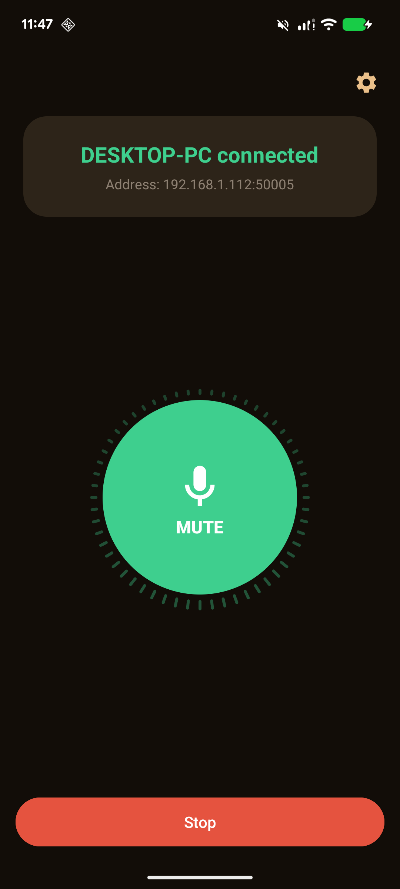
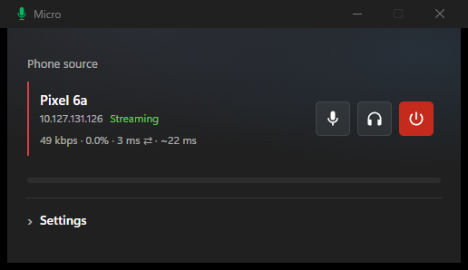

<div align="center">


# Micro

**Turn your Android phone into a wireless, end-to-end encrypted microphone for your PC.**


</div>

---

The phone captures the mic, encodes it with **native Opus** and streams it over Wi-Fi. A small
desktop app decodes it (with **RNNoise** noise suppression), and feeds it into a **virtual
microphone** so any app — Discord, Zoom, OBS, Teams — sees the phone as a real mic.

```
┌──────────────────────────┐          Wi-Fi (UDP)         ┌────────────────────────────────┐
│  Android (server)        │     encrypted Opus frames    │  Desktop client (Tauri)        │
│  mic → Opus → ChaCha20   │ ───────────────────────────> ⁠⁠│  decrypt → Opus → RNNoise →    │
│  (X25519 + FEC)          │ <───── pairing/keepalive ─── │  cpal (native) → virtual mic   │
└──────────────────────────┘                              └────────────────────────────────┘
                                                                          │
                                                          Discord / Zoom / OBS see a microphone
```

## Screenshots

| Phone — the server | Desktop — the client |
|:---:|:---:|
|  |  |

## Features

- 🔊 **Native audio** — libopus encode (NDK) on the phone, libopus decode + RNNoise on the PC. 10 ms frames, low latency.
- 🔐 **End-to-end encryption** — X25519 ECDH + ChaCha20-Poly1305, **forward secrecy** (ephemeral keys), authenticated by **pinned identities**.
- 🤝 **SAS pairing, authorized on both ends** — a 4-digit code shown on the phone (with a commitment step → real MITM protection) is typed on the PC, then the phone's user taps **Allow**. Nobody on the LAN can pair silently.
- 🛡️ **Resilience** — Opus in-band **FEC** (always coded, not only after loss), packet-loss concealment, **adaptive bitrate**, adaptive jitter buffer, automatic session recovery after a Wi-Fi blip, phone restart or IP change.
- 📡 **Auto-discovery** — the client finds the phone on the LAN (no typing IPs); manual IP also supported.
- 🎚️ **Controls** — volume, RNNoise toggle, VAD gate, buffer/latency, monitor-to-headphones test, configurable global mute hotkey.
- 🔋 **Battery-aware** — the phone releases the microphone whenever no computer is connected and marks its packets DSCP EF (Wi-Fi voice queue).
- 🖥️ **Native desktop app** — Tauri (Rust + webview), tray, system theme + accent, i18n (EN/RU), tiny binary.
- 🐧 **Virtual mic, per OS** — auto-created on Linux; VB-Cable on Windows; BlackHole on macOS.

## Repository layout

| Path | What |
|------|------|
| [`android/`](android) | **Server** — Android app (Kotlin + NDK libopus). Captures the mic, encrypts, streams. |
| [`tauri/`](tauri) | **Client** — desktop app (Tauri/Rust). Decodes, denoises, feeds the virtual mic. |
| [`scripts/`](scripts) | One build script per OS (installs the system dependencies on Linux). |
| [`PROTOCOL.md`](PROTOCOL.md) | UDP wire format: discovery, SAS pairing, encryption, audio. |
| [`BUILD.md`](BUILD.md) | Build commands for every platform. |
| [`CONTRIBUTING.md`](CONTRIBUTING.md) | How to build, test and propose changes. |
| [`SECURITY.md`](SECURITY.md) | Threat model and how to report a vulnerability. |
| [`CHANGELOG.md`](CHANGELOG.md) | What changed in each release, and whether it breaks the wire format. |

## Quick start

1. **Phone:** install the APK from the [latest release](https://github.com/metwisom/Micro/releases/latest)
   — or build it yourself, see [BUILD.md](BUILD.md). Open Micro; the server auto-starts.
2. **PC:** install the client from the same [release page](https://github.com/metwisom/Micro/releases/latest)
   (Windows `.exe`, Linux `.deb`/`.AppImage`); on macOS build it with [`scripts/build-macos.sh`](scripts).
   To hack on it instead: `cd tauri && npm install && npm run tauri dev`.

> Both ends must be the **same release** — the wire format changed in 2.0.0 and a mismatched pair
> never connects. Check [CHANGELOG.md](CHANGELOG.md) before mixing versions.
3. The phone appears as a button — click it, enter the **4-digit code** shown on the phone, then tap **Allow** on the phone.
4. Pick the **virtual mic** as the output device; select it as the microphone in your app.

Virtual microphone:

| OS | Virtual mic |
|----|-------------|
| **Linux** | Created automatically at launch (PulseAudio/PipeWire sink "Micro"). |
| **Windows** | Install [VB-CABLE](https://vb-audio.com/Cable/); the client auto-selects `CABLE Input`. |
| **macOS** | Install [BlackHole](https://github.com/ExistentialAudio/BlackHole); select it as output. |

Full build instructions → [BUILD.md](BUILD.md).

## Security

Confidentiality + mutual authorization on the LAN: ECDH gives confidentiality, the pinned long-term
keys authenticate every session (HELO and KEYS carry tags only the paired pair can compute), and the
ephemeral keys give forward secrecy. Pairing needs both the 4-digit SAS (with a commitment step that
defeats an active man-in-the-middle, ≈ 1 in 10000 per attempt) **and** an explicit Allow on the
phone. All control traffic is sealed and replay-protected; nothing sent in plaintext can move, mute,
re-key or end a live session. Details in [PROTOCOL.md](PROTOCOL.md). Note: this is a hobby project,
not an audited security product.

Found a vulnerability? Please report it privately — see [SECURITY.md](SECURITY.md).

## License

[MIT](LICENSE) © metwisom

Third-party components keep their own licences — RNNoise (BSD 3-Clause, vendored in
[`tauri/src-tauri/rnnoise/`](tauri/src-tauri/rnnoise)) and Opus (BSD 3-Clause, fetched at build
time). See [NOTICE](NOTICE) for the full attribution.
